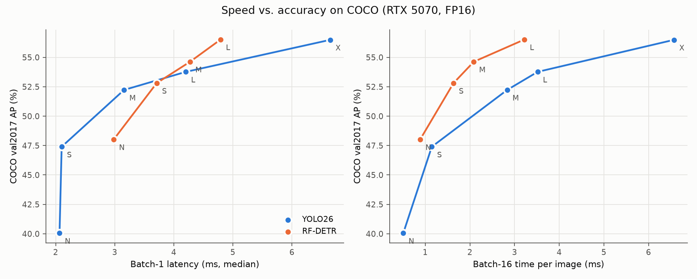
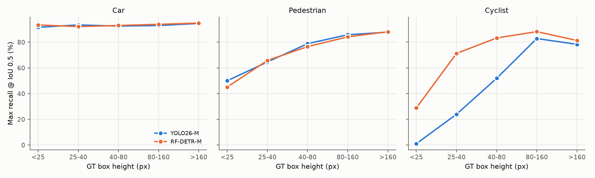
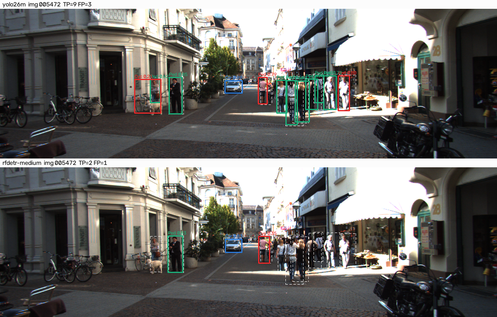

# YOLO26 vs RF-DETR: COCO Accuracy and Zero-Shot Transfer to KITTI

**CMPE 249 — Homework: 2D Object Detection, Track A (Experimental)**
Jasper Morgal · November 2026

> **Summary.** I compared the newest YOLO (**YOLO26**) with the strongest real-time DETR (**RF-DETR**) at three
> matched speed levels on one GPU. Both were tested on **COCO val2017** and, without retraining, on **KITTI**.
>
> 1. On COCO, RF-DETR is more accurate at every speed level (+0.6 to +2.7 AP). The gain is mostly on large objects.
> 2. On KITTI the gap almost disappears. Both families lose accuracy on the same classes by similar amounts,
>    so the domain shift depends on the class, not the architecture.
> 3. YOLO26 is better in crowded scenes and on small pedestrians. RF-DETR is better on cyclists.
> 4. Which model is "faster" depends on batch size: RF-DETR is slower for single images but faster in batches of 16.

**Code, configs and logs:** [github.com/Jasper-256/cmpe249-yolo26-vs-rfdetr](https://github.com/Jasper-256/cmpe249-yolo26-vs-rfdetr) (commands in the Appendix).

## 1. Models and datasets

**Models.** I chose the newest model from each family that has official weights. For the DETR side I also considered
DEIMv2 [12] and D-FINE [13], but RF-DETR has the highest published COCO AP at each real-time size.

| | YOLO26 [1] | RF-DETR [2] |
|---|---|---|
| Family | One-stage CNN, anchor-free, dense grid | Detection transformer (LW-DETR [8] design), 300 object queries |
| Backbone | CNN (C3k2 blocks + one self-attention block) | DINOv2 ViT-S [5], pre-trained without labels |
| Neck | PAN-FPN, three feature maps (stride 8, 16, 32) | One stride-16 feature map |
| Head | Two heads: one-to-many (needs NMS) and one-to-one (NMS-free), an idea from YOLOv10 [7] | Deformable-attention decoder [4], 2–4 layers |
| Training targets | Task-aligned assignment [6] (top-k anchors per object) | Hungarian matching [3] (one query per object) |
| Losses | BCE + CIoU [15] (no DFL) | IoU-aware BCE [9] + L1 + GIoU [14] |
| Post-processing | Top-300 over (anchor × class); no NMS in e2e mode | Top-300 over (query × class); no NMS |
| How sizes scale | Depth and width (2.4 M → 55.7 M params) | Input size (384 → 704 px) and decoder depth; backbone fixed (~30–34 M params) |
| Code | `ultralytics` 8.4.197 [17] | `rfdetr` 1.11.2 [18] |

I read the code to confirm the main rows above:
YOLO26's NMS-free top-K is in `ultralytics/nn/modules/head.py` (`Detect.get_topk_index`), and its two-head loss is `E2ELoss` in `ultralytics/utils/loss.py`.
RF-DETR's matching is `HungarianMatcher` in `rfdetr/models/matcher.py`, and its top-K output is `PostProcess._select_topk` in `rfdetr/models/postprocess.py`.

**Important setting.** By default, Ultralytics runs YOLO26 with its one-to-many head **plus NMS**. I used `nms=False` to run
the NMS-free head, so both models are end-to-end. I also ran the NMS head once to check. It gave the same COCO AP
(±0.1) but 3–4 points lower AR100, so I do not report it further.

**Datasets.**

* **COCO val2017** [16]: 5,000 images, 80 classes. This is still the official COCO detection validation set.
* **KITTI 2D object** [10]: driving images (1242×375). The official test labels are not public, so I used all
  **7,481 labelled training images**. Neither model was trained on KITTI, so this is a zero-shot test.

**KITTI label mapping.** KITTI and COCO use different classes. I mapped them as follows. "Ignored" boxes count as
neither correct nor wrong, which is the rule in the official KITTI devkit [20].

| KITTI class | Matched to COCO prediction | Ignored KITTI boxes |
|---|---|---|
| Car | car | Van (COCO has no van class) |
| Pedestrian | person | Person_sitting, Cyclist (the rider is a "person" in COCO) |
| Cyclist | person + bicycle that overlap (box = union of the two) | — |
| Truck | truck | Van, Misc |
| Tram | train | — |
| DontCare | — | ignored for all classes |

A KITTI "Cyclist" box covers both the rider and the bike. A COCO bicycle box alone matched fewer than 5 % of them,
so I combined each person with the bicycle under it.

## 2. Experimental setup

| Item | Setting |
|---|---|
| Hardware | NVIDIA RTX 5070 (12 GB), AMD Ryzen 7 9800X3D |
| Software | Python 3.12, PyTorch 2.11 (CUDA 12.8, cuDNN 9.19), ultralytics 8.4.197, rfdetr 1.11.2, pycocotools 2.0.11 |
| Checkpoints | COCO-pretrained `yolo26{s,m,l}.pt` and `rf-detr-{nano,medium}.pth`, `rf-detr-large-2026.pth` (all sizes were also benchmarked for Figure 1) |
| Input size | YOLO26: 640 px, aspect ratio kept (KITTI → 640×224). RF-DETR: square 384 / 576 / 704 px (its training setting) |
| Thresholds | Score ≥ 0.001, max 300 boxes per image, no NMS (standard AP setting) |
| Precision | FP16 |
| Metrics | pycocotools [19] AP[.5:.95], AP50, AP75, AP by size, AR100, per-class AP. On KITTI also the KITTI-style AP<sub>R40</sub> [11] for "moderate" objects (Car at IoU 0.7, others at 0.5) |

**Matching compute.** I measured the network time of every model size on the GPU: FP16, 50 warm-up and 300
timed runs. Each pair below has a similar time per image:

| Pair | Model | Params | Latency, batch 1 | Time/image, batch 16 | Full `predict()` time | GPU memory, batch 16 |
|---|---|---|---|---|---|---|
| Small | YOLO26-S | 9.5 M | 2.10 ms | 1.15 ms | 2.90 ms | 733 MB |
| | RF-DETR-N | 30.5 M | 2.98 ms | 0.89 ms | 4.14 ms | 374 MB |
| Medium | YOLO26-M | 20.4 M | 3.16 ms | 2.83 ms | 3.23 ms | 1427 MB |
| | RF-DETR-M | 33.7 M | 4.28 ms | 2.09 ms | 5.39 ms | 604 MB |
| Large | YOLO26-L | 24.8 M | 4.20 ms | 3.52 ms | 4.17 ms | 1586 MB |
| | RF-DETR-L | 33.9 M | 4.79 ms | 3.22 ms | 5.97 ms | 798 MB |

The pairs are close, but not equal. For single images RF-DETR is 14–42 % slower, and 43–67 % slower through
each library's full `predict()` pipeline. In batches of 16 it is 9–26 % faster and uses about half the memory.

## 3. Results

**COCO val2017** (5,000 images):

| Model | AP | AP50 | AP75 | AP small | AP medium | AP large | AR100 | Published AP |
|---|---|---|---|---|---|---|---|---|
| YOLO26-S | 47.4 | 63.8 | **51.6** | **29.4** | 52.0 | 64.0 | **68.0** | 47.8 |
| RF-DETR-N | **48.0** | **67.1** | 51.1 | 25.0 | **53.1** | **70.9** | 65.1 | 48.4 |
| YOLO26-M | 52.2 | 69.3 | 57.0 | 35.5 | 56.8 | 68.3 | 72.1 | 52.5 |
| RF-DETR-M | **54.6** | **73.5** | **59.0** | **35.8** | **59.7** | **73.6** | **72.4** | 54.7 |
| YOLO26-L | 53.8 | 70.7 | 58.8 | 37.3 | 58.0 | 69.5 | 73.1 | 54.4 |
| RF-DETR-L | **56.5** | **75.1** | **61.3** | **38.9** | **61.1** | **74.0** | **74.2** | 56.5 |

My results are within 0.6 AP of the published numbers. To check my pipeline, I also ran Ultralytics' own `yolo val`
on YOLO26-S and got the same small gap, so it comes from preprocessing details, not from my evaluation code.

**KITTI** (7,481 images, no retraining). "mAP" is the mean of Car, Pedestrian and Cyclist AP[.5:.95]:

| Model | mAP | Car AP | Ped AP | Cyc AP | Truck AP | Tram AP | Car R40 (IoU .7) | Ped R40 | Cyc R40 | AR100 |
|---|---|---|---|---|---|---|---|---|---|---|
| YOLO26-S | **26.4** | **46.2** | **24.9** | 8.2 | 19.4 | 9.1 | **69.9** | **66.0** | 27.4 | 43.2 |
| RF-DETR-N | 26.1 | 46.0 | 22.1 | **10.2** | **27.2** | **15.1** | 68.4 | 59.9 | **32.6** | **43.8** |
| YOLO26-M | 28.6 | 48.4 | **26.4** | 11.0 | 28.3 | 16.7 | 71.8 | **69.3** | 36.5 | 45.5 |
| RF-DETR-M | **30.1** | **49.8** | 25.9 | **14.7** | **31.6** | **18.3** | **72.7** | 67.6 | **47.4** | **49.3** |
| YOLO26-L | 29.1 | 49.4 | 26.2 | 11.5 | **33.6** | 16.2 | **73.9** | 68.6 | 39.6 | 46.2 |
| RF-DETR-L | **31.2** | **50.6** | **26.7** | **16.4** | 31.9 | **19.1** | 73.6 | **69.3** | **52.9** | **50.5** |

R40 columns use KITTI's "moderate" difficulty. Full tables (all 9 sizes, easy/hard splits) are in `results/tables.md`.

## 4. Analysis

### 4.1 Speed–accuracy trade-off



*Figure 1. COCO AP vs. time per image for all sizes of both families.*

* **Single images (left).** YOLO26 is the better choice below about 3.2 ms. Its smallest models are very fast, while
  RF-DETR cannot get faster than ~3 ms because every size keeps the same ViT backbone. Above ~4.3 ms RF-DETR is
  better: RF-DETR-L matches YOLO26-X (56.5 AP) in 4.8 ms instead of 6.7 ms.
* **Batches of 16 (right).** RF-DETR is better at every point. A ViT is mostly large matrix multiplications, which
  run efficiently on a GPU once the batch is large. YOLO's high-resolution conv features also need about twice the
  memory (table in §2).

### 4.2 Architecture comparison: CNN with dense grid vs. transformer with queries

**Where RF-DETR wins on COCO.** RF-DETR's lead is mostly in AP50 (+3.3 to +4.4) and on large objects (+4.5 to
+6.9 AP large), and smaller in AP75 (−0.5 to +2.5). So RF-DETR is better at *recognising* objects, likely thanks
to its DINOv2 backbone, but not much better at *placing* the box. On small objects YOLO26 wins at the small level
(29.4 vs 25.0). YOLO26 uses a stride-8 feature map, while RF-DETR-N has only a stride-16 map on a 384 px input.

**Crowded scenes.** I split COCO images by the number of objects (medium pair):

| Model | 1–5 objects (2,769 imgs) | 6–15 objects (1,541) | 16+ objects (642) | Person AP, images with ≥10 people (403) |
|---|---|---|---|---|
| YOLO26-M | 64.5 | 52.4 | 42.6 | **58.7** |
| RF-DETR-M | **68.7** | **54.6** | **43.4** | 55.6 |

RF-DETR's lead shrinks as scenes get crowded (+4.2 → +2.2 → +0.8). On crowds of people it loses by 3.1 AP. A likely
reason is the fixed set of 300 queries on a coarse stride-16 map, which gives few candidates for many small,
overlapping people. YOLO26 has 8,400 grid points, 6,400 of them at stride 8. The same weakness appears on KITTI
pedestrians (§5).

### 4.3 Cross-dataset generalization (COCO → KITTI)

How much each class loses from COCO to KITTI (AP[.5:.95], medium pair; the other pairs show the same pattern):

| COCO class → KITTI class | YOLO26-M | RF-DETR-M |
|---|---|---|
| car → Car | 51.7 → 48.4 (−3.3) | 52.3 → 49.8 (−2.5) |
| truck → Truck | 45.5 → 28.3 (−17.2) | 49.9 → 31.6 (−18.3) |
| bicycle → Cyclist | 40.7 → 11.0 (−29.7) | 42.0 → 14.7 (−27.3) |
| person → Pedestrian | 64.1 → 26.4 (−37.7) | 62.9 → 25.9 (−36.9) |
| train → Tram | 76.9 → 16.7 (−60.1) | 80.0 → 18.3 (−61.7) |
| All classes, small objects | 35.5 → 19.4 | 35.8 → 15.0 |

* **The loss depends on the class, not the model.** The two families lose almost the same amount on each class.
  Between classes, the loss ranges from about 3 to 60 points.
* **Cars transfer well.** Cars in driving scenes look like cars in COCO street photos. At IoU 0.5, both models reach
  about 90 % R40 on moderate KITTI cars.
* **Pedestrians lose most at strict IoU.** Pedestrian AP50 stays near 60, but AP[.5:.95] drops to ~26. The predicted
  boxes are about 6 % shorter than KITTI's boxes (median), so KITTI draws people a bit larger than COCO does. This
  costs a lot of AP at IoU 0.75 and above.
* **Truck and Tram are label problems.** Only 34 % (YOLO26) / 49 % (RF-DETR) of trams are detected as "train". 12–14 % are
  called "bus", and the rest are missed, often because the tram is cut off at the image edge. KITTI vans are called
  "car" or "truck" about equally often, which is why I ignore them. Fine-tuning on KITTI would fix most of these losses.
* **Small objects** lose more with RF-DETR (−20.8 vs −16.1 AP small), which matches its coarser feature map.
* **Overall**, RF-DETR's COCO lead (+0.6 / +2.4 / +2.7) shrinks on KITTI (−0.3 / +1.5 / +2.1 mAP). Almost all of
  the remaining lead comes from cyclists.

## 5. Failure analysis

For each class I chose each model's score threshold with the best F1 (IoU 0.5) and sorted every detection above it
into one error type. A separate threshold per model is needed because the two families score boxes very differently.

| Medium pair | Class | Threshold | Precision | Recall | F1 | Box misplaced | Wrong class | Background |
|---|---|---|---|---|---|---|---|---|
| YOLO26-M | Car | 0.47 | **88.9** | 75.1 | **81.4** | 1,849 | 5 | 642 |
| RF-DETR-M | Car | 0.35 | 77.5 | **84.0** | 80.6 | 4,061 | 34 | 2,585 |
| YOLO26-M | Pedestrian | 0.36 | 66.1 | **62.4** | **64.2** | 461 | 3 | 928 |
| RF-DETR-M | Pedestrian | 0.76 | **84.2** | 41.7 | 55.8 | 120 | 1 | 230 |
| YOLO26-M | Cyclist | 0.17 | **56.9** | 39.5 | 46.6 | 93 | 234 | 136 |
| RF-DETR-M | Cyclist | 0.34 | 51.3 | **52.3** | **51.8** | 107 | 467 | 235 |



*Figure 2. Best possible recall (all boxes, IoU ≥ 0.5) by object height on KITTI, medium pair.*

**Main failure types:**

1. **Crowded pedestrians (RF-DETR's main weakness).** RF-DETR does find the people, but with low scores. Its best
   threshold is 0.76, which leaves only 42 % recall (YOLO26: 62 %). In the image below, YOLO26-M finds 9 people in
   a busy street and RF-DETR-M finds 2.
   
   *Figure 3. KITTI image 005472. Top: YOLO26-M, bottom: RF-DETR-M. White dashed = ground truth; blue / teal / amber =
   correct car / pedestrian / cyclist; red = false positive.*
2. **Small objects.** Car recall stays above 90 % at every size, but pedestrian and cyclist recall drop sharply below
   40 px (Figure 2). Below 25 px, pedestrian recall is at most 50 % for both models. RF-DETR finds small cyclists
   better, likely because it detects small bicycles better.
3. **Missing labels in KITTI.** Many of RF-DETR's "background" car errors are real parked cars far away that KITTI
   did not label (see `report/figs/qual_2_005311.png`). Part of its lower car precision is therefore a labelling issue.
4. **Misplaced boxes on cars.** This is the largest car error for both models: mostly cars cut off at the image edge
   or hidden in parking rows. KITTI requires IoU 0.7 for cars, which costs both models about 17 R40 points
   compared with IoU 0.5.
5. **Cyclist vs. pedestrian.** Most cyclist errors land on a pedestrian, usually a person standing or walking next to a parked bicycle. My
   person + bicycle rule cannot tell riding from standing. A COCO model has no "rider" class, so this needs
   fine-tuning or an open-vocabulary detector.

## 6. Conclusions

* **On COCO, RF-DETR is more accurate at matched speed** (+0.6 to +2.7 AP), mostly because it recognises large objects
  better. It is also faster and lighter on memory when images are processed in batches.
* **On KITTI without retraining, the two families are close** (−0.3 to +2.1 mAP). The loss from COCO to KITTI is
  decided by the class (labels, box style, object size), not by YOLO vs. DETR.
* **YOLO26 suits crowded scenes with small objects better.** Its dense stride-8 grid finds more small and overlapping
  people, and it is faster for single images.
* **"Same speed" must be defined.** RF-DETR is slower for single images but faster in batches, so any speed claim
  should name the batch size and runtime.
* **Next step:** fine-tune both models on KITTI. Most of the remaining errors (Tram, Truck, Cyclist, box style)
  are label mismatches that fine-tuning should fix.

## References

**Research papers**

1. G. Jocher, J. Qiu, M. Liu, S. Lyu, F. C. Akyon, M. E. Kalfaoglu. *Ultralytics YOLO26: Unified Real-Time End-to-End Vision Models.* arXiv:2606.03748, 2026.
2. I. Robinson, P. Robicheaux, M. Popov, D. Ramanan, N. Peri. *RF-DETR: Neural Architecture Search for Real-Time Detection Transformers.* ICLR 2026, arXiv:2511.09554.
3. N. Carion et al. *End-to-End Object Detection with Transformers (DETR).* ECCV 2020.
4. X. Zhu et al. *Deformable DETR: Deformable Transformers for End-to-End Object Detection.* ICLR 2021.
5. M. Oquab et al. *DINOv2: Learning Robust Visual Features without Supervision.* TMLR 2024.
6. C. Feng et al. *TOOD: Task-aligned One-stage Object Detection.* ICCV 2021.
7. A. Wang et al. *YOLOv10: Real-Time End-to-End Object Detection.* NeurIPS 2024.
8. Q. Chen et al. *LW-DETR: A Transformer Replacement to YOLO for Real-Time Detection.* arXiv:2406.03459, 2024.
9. Z. Cai et al. *Align-DETR: Improving DETR with Simple IoU-aware BCE Loss.* arXiv:2304.07527, 2023.
10. A. Geiger, P. Lenz, R. Urtasun. *Are we ready for Autonomous Driving? The KITTI Vision Benchmark Suite.* CVPR 2012.
11. A. Simonelli et al. *Disentangling Monocular 3D Object Detection* (40-point AP, used by KITTI). ICCV 2019.
12. S. Huang et al. *Real-Time Object Detection Meets DINOv3 (DEIMv2).* arXiv:2509.20787, 2025.
13. Y. Peng et al. *D-FINE: Redefine Regression Task in DETRs as Fine-grained Distribution Refinement.* ICLR 2025.
14. H. Rezatofighi et al. *Generalized Intersection over Union.* CVPR 2019.
15. Z. Zheng et al. *Distance-IoU Loss: Faster and Better Learning for Bounding Box Regression* (CIoU). AAAI 2020.
16. T.-Y. Lin et al. *Microsoft COCO: Common Objects in Context.* ECCV 2014.

**Repositories and documentation**

17. Ultralytics. *YOLO26 documentation and source* — https://docs.ultralytics.com/models/yolo26/ , https://github.com/ultralytics/ultralytics
18. Roboflow. *RF-DETR repository* — https://github.com/roboflow/rf-detr
19. COCO API / pycocotools — https://github.com/cocodataset/cocoapi
20. KITTI 2D object benchmark and devkit — https://www.cvlibs.net/datasets/kitti/eval_object.php

## Appendix — Reproducibility

All code, configs, metrics and logs are in [github.com/Jasper-256/cmpe249-yolo26-vs-rfdetr](https://github.com/Jasper-256/cmpe249-yolo26-vs-rfdetr).

**Setup and data**
```bash
uv venv --python 3.12 .venv && source .venv/bin/activate
uv pip install torch torchvision --index-url https://download.pytorch.org/whl/cu128
uv pip install -r requirements-lock.txt            # ultralytics 8.4.197, rfdetr 1.11.2, pycocotools 2.0.11
# COCO: images.cocodataset.org/zips/val2017.zip + annotations_trainval2017.zip
# KITTI: s3.eu-central-1.amazonaws.com/avg-kitti/data_object_image_2.zip + data_object_label_2.zip
python scripts/make_kitti_gt.py                    # KITTI labels -> COCO format with the class mapping of §1
```

**Experiments**

| Experiment | Models | Dataset / split | Input | Thresholds | Command |
|---|---|---|---|---|---|
| Speed and memory | all sizes | random input | native size | — | `bash scripts/run_bench.sh` |
| COCO accuracy | all sizes | COCO val2017 (5,000) | YOLO 640 (aspect kept); RF-DETR 384–704 square | score ≥ 0.001, top-300, no NMS | `bash scripts/run_coco.sh` |
| KITTI accuracy | all sizes | KITTI training (7,481) | same | same | `bash scripts/run_kitti.sh` |
| Crowd and error analysis | medium pair | COCO / KITTI | — | best-F1 threshold per model | `python scripts/crowd_analysis.py …` · `python scripts/kitti_errors.py …` |
| Tables and figures | — | — | — | — | `python scripts/analyze.py` · `python scripts/visualize.py yolo26m rfdetr-medium` |

One model run, for example:
```bash
python scripts/predict.py --family yolo   --size m      --dataset kitti --head e2e   # YOLO26-M, NMS-free head
python scripts/predict.py --family rfdetr --size medium --dataset kitti              # RF-DETR-M, 576x576
python scripts/evaluate.py kitti results/dets/kitti_yolo26m.json results/dets/kitti_rfdetr-medium.json
```

Every run saves its detections and a `.meta.json` file with timing, GPU, and library versions. All runs used the
hardware and software listed in §2.
